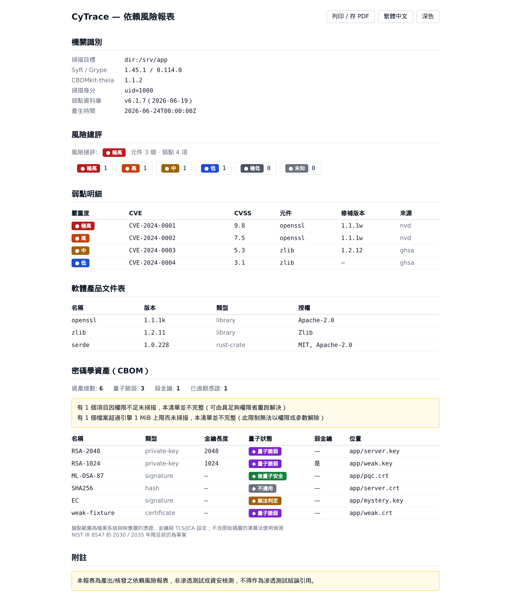

# CyTrace

> 地端、無網際網路（軍用網路）場域的**軟體依賴風險報表產生器**。
> Air-gapped software dependency risk report generator for on-premise / military networks.

CyTrace 封裝 **Syft**（產 SBOM）、**Grype**（比對 CVE）與 **CBOMkit-theia**（密碼學資產盤點）三個 Apache-2.0 工具，
對原始碼目錄、容器映像或檔案系統產出可併入交件的文件：

- **依賴風險報表**：風險總評與弱點明細。
- **軟體產品文件表（SBOM）**：CycloneDX，可另產 SPDX 2.3。
- **密碼學資產清單（CBOM）與量子脆弱判定**：選用。

兩種用法共用同一條掃描管線，都不需要網路：

- **命令列**：單一靜態執行檔，跑完產出**離線單檔 HTML 報表**；以退出碼作為 CI 閘門。
- **Web 服務模式**（`cytrace serve`）：場域內的集中掃描伺服器。使用者在瀏覽器登入控制台，上傳或指定掃描目標、查看與下載報表。以容器交付。

目前版本：**v0.6.0**（2026-10-09；變更見 [CHANGELOG.md](CHANGELOG.md)）。

## 報表範例



報表是自包含的**離線單檔 HTML**：不發出任何外部請求，可攜帶，雙擊即可用瀏覽器開啟。內容分為六個區塊：

1. 機關識別
2. 風險總評
3. 弱點明細：受影響元件的版本、所在位置、公告來源
4. 軟體產品文件表：每個元件的 purl 與所在位置
5. 密碼學資產：加 `--cbom` 時才有
6. 附註與免責

每個區段的標題下方都標明資料出自哪個工具、哪個版本，以及哪份漏洞資料庫快照。
報表內可切換中文／英文與深色主題、點嚴重度徽章篩選，也可以一鍵列印或另存 PDF。

## 離線運作

CyTrace 設計成在**完全斷網**的環境執行，執行期、報表與 CI 都不連網：

- **漏洞比對**：只使用隨附的 grype 漏洞資料庫快照，資料庫的自動更新與年齡驗證都關閉，
  所以快照舊了也照常比對，不會因此拒跑。
- **引擎的版本檢查**：Syft、Grype 掃描時會嘗試連網檢查新版本。產品呼叫引擎時一律關閉這項檢查（#64），
  離線安裝包的 wrapper 與容器映像也各自關閉。**v0.6.0 的執行檔例外**：直接執行它（不經 wrapper 或容器）時，
  這項檢查仍會連網，下一版起修正。斷網時這項檢查只會失敗、不影響掃描結果；在有網段的機器上請透過 wrapper 或容器執行 v0.6.0。
- **報表**：以 CSP（`default-src 'none'`、`connect-src 'none'`）鎖死外部連線，字型等資源全部內嵌。
- **離線安裝包**：一個目錄內含執行檔、三個釘選版引擎與漏洞資料庫快照，外加離線執行 wrapper（`cytrace-offline`），目標機不需要另外安裝任何東西。
- **Web 服務模式**：控制台以內嵌方式隨執行檔提供。上傳的掃描目標只送到同場域的 CyTrace 伺服器，掃描結束即刪除（NFR-09）。
- **CBOM**：`--cbom` 只接受本地目錄、docker save 的 tar 或 OCI layout，不接受 registry 參照，所以不會為了拉映像而連網。

**需要準備的**：漏洞資料庫快照解開後約 3.0 GB（2026-10 實測 v6.1.10，會隨時間成長）。
離線安裝包已內含快照；容器版則要另以 volume 掛入 `/db`。
快照只反映打包當下的漏洞資料，更新方式見 [DELIVERY_SOP §5](docs/DELIVERY_SOP.md)。

**驗證現況**：

- 已驗證：v0.6.0 的 Linux 離線安裝包驗章與校驗通過，並在沒有任何網路介面的環境（`unshare -rn`）完成 `run --cbom` 掃描。
- 尚未驗證：在實體斷網的場域機器上，從驗章、安裝、掃描到判讀報表完整走一輪；Windows 版在斷網環境的執行。
  這兩項依 [場域驗收清單](docs/FIELD_ACCEPTANCE.md) 執行。

## 設計原則

- **零外連（air-gapped）**：見上節。
- **穩定優先**：Rust 靜態執行檔、零 runtime 依賴。引擎版本釘選在 `scripts/versions.env`，漏洞資料庫以固定快照交付；建置可重現，並以 golden baseline 做回歸測試。
- **可稽核交付**：
  - 交付物附 SHA-256 校驗與 minisign 簽章。
  - 報表標註工具版本、資料庫快照版本與日期，以及每筆資料的來源。
  - 隨附 CyTrace 自己的 SBOM。
- **雙語 i18n**：`zh-TW`（預設）與 `en-US`。報表、控制台、終端訊息與 `--help` 都雙語，程式內不硬編碼使用者看得到的字串。
- **供應鏈純淨**：
  - 第三方工具本體皆為 Apache-2.0（Syft、Grype、CBOMkit-theia）。
  - 明確禁用中國來源的依賴，規範對象是專案與組織。
  - CI 以 cargo-deny 檢查授權、來源白名單與安全通報。

## 下載與驗章

預編譯檔見 [GitHub Releases](https://github.com/astroicers/CyTrace/releases)：

| 檔案 | 說明 |
|------|------|
| `cytrace-x86_64-linux` | Linux x86_64，musl 靜態執行檔，零 runtime 依賴 |
| `cytrace-x86_64-windows.exe` | Windows x86_64，msvc 靜態 CRT，不需安裝 VC++ 可轉散發套件 |
| `cbomkit-theia-windows-amd64.exe` | CBOM 引擎 Windows 版（自原始碼交叉編譯），組 Windows 安裝包時使用 |
| `SHA256SUMS`、`SHA256SUMS.minisig` | 上列執行檔的校驗與其 minisign 簽章 |
| `cytrace-vX.Y.Z-image.tar`、`SHA256SUMS-image`、`IMAGE_DIGEST.txt` | 容器映像離線包、其校驗與 digest |
| `cytrace-image.sbom.cdx.json` | 容器映像本身的 SBOM（CycloneDX） |

Release 不含 Syft、Grype 引擎與漏洞資料庫快照。**場域交付請使用離線安裝包或容器映像**（見下方「地端離線交付」）。

**驗章**：Release 的 `SHA256SUMS` 由交付工作站在發布後簽章；離線安裝包的 `SHA256SUMS` 則在打包時簽（DELIVERY_SOP §3）。
兩者用同一把交付公鑰，金鑰 ID `CE187AD55AF18DB0`，公鑰檔為 `keys/cytrace.pub`：

```
RWSwjfFa1XoYzuT985oJIvN4GEWd8ZT1iTJjmc+Jyx7TZ8C0H7Z8pbnJ
```

```bash
minisign -Vm SHA256SUMS -P <公鑰字串>    # 驗簽章（真實性）
sha256sum -c SHA256SUMS                  # 驗校驗（完整性）
```

- 這把金鑰從 v0.6.0 開始使用。v0.5.0 的簽章請以舊公鑰驗證（金鑰 ID `055ACC6F1822B10E`，
  公鑰檔 `keys/retired/cytrace-055ACC6F1822B10E.pub`），金鑰沿革見 DELIVERY_SOP §3。
- 場域請以交付驗收單上**帶外抄錄**的公鑰字串驗章，不要用隨安裝包一起帶進去的公鑰。

## 快速開始（開發機）

```bash
# 1) 安裝釘選版引擎（一次，需網路）。版本必須等於 scripts/versions.env——
#    其他版本可能輸出 grype 讀不懂的格式（例如 syft 1.51 預設產 CycloneDX 1.7）
curl -sSfL https://raw.githubusercontent.com/anchore/syft/main/install.sh  | sh -s -- -b ~/.local/bin v1.45.1
curl -sSfL https://raw.githubusercontent.com/anchore/grype/main/install.sh | sh -s -- -b ~/.local/bin v0.114.0
export PATH="$HOME/.local/bin:$PATH"
grype db update                       # 下載漏洞資料庫（線上一次）
scripts/build-theia.sh                # 選用：--cbom 用的 CBOM 引擎（自原始碼建置，需要 Docker）

# 2) 建置
cargo build --release

# 3) 掃描並產出報表（達 high 以上時以退出碼 2 結束，供 CI 使用）
./target/release/cytrace run dir:/path/to/project --fail-on high -o report.html
./target/release/cytrace run dir:/path/to/project --cbom -o report.html   # 一併盤點密碼學資產
./target/release/cytrace run docker-archive:app.tar -o app.html          # 掃描 docker save 匯出的映像
```

## 地端離線交付

在有網路的建置機產出**離線安裝包**，簽章後攜入斷網的目標機。安裝包是一個可攜目錄，內含：

- cytrace 執行檔
- 釘選版的 Syft、Grype、CBOMkit-theia
- 漏洞資料庫快照
- CyTrace 自己的 SBOM、NOTICE、CHANGELOG
- `SHA256SUMS` 與 `SHA256SUMS.minisig`
- 離線執行 wrapper

| 平台 | 打包 | 目標機上執行 |
|---|---|---|
| Linux | `make package` | `./cytrace-offline run dir:/path` |
| Windows | `pwsh scripts/package.ps1`（需 PowerShell 7） | `.\cytrace-offline.ps1 run dir:C:\path` |

- **Windows 可以直接用 Release 的執行檔打包**：`package.ps1 -CytraceExe <路徑>\cytrace-x86_64-windows.exe`。
  建置機因此不需要 Rust 與 Visual Studio Build Tools，包內的 exe 也就是公開、已簽章的同一支。
- 腳本會先核對下列各項，不符就中止：
  - exe 自報的版本
  - 原始碼正好停在對應的 tag
  - 工作樹沒有修改
  - 引擎版本與 `versions.env` 一致

打包、簽章、目標機安裝、漏洞資料庫更新與容器搬運的完整步驟，見 [docs/DELIVERY_SOP.md](docs/DELIVERY_SOP.md)。
到場驗收依 [docs/FIELD_ACCEPTANCE.md](docs/FIELD_ACCEPTANCE.md)。這份清單**不在安裝包內**，請於進場前列印。

## 子命令

| 指令 | 作用 |
|------|------|
| `cytrace run <目標> [--fail-on 等級] [-o 檔] [--cbom] [--fail-on-quantum-vulnerable]` | 一次完成：產 SBOM → 比對弱點 → 出報表（預設 `./<目標名>.report.html`） |
| `cytrace batch <目標…> [--fail-on 等級] [-o 目錄] [--cbom] [--fail-on-quantum-vulnerable]` | 多目標批次掃描，每個目標各出一份報表；任一目標達門檻即整體以 2 結束 |
| `cytrace scan <目標> [-o 目錄] [--cbom] [--spdx]` | 只產原始資料：`sbom.cdx.json` 與 `grype.json`；`--spdx` 另產 `sbom.spdx.json`（SPDX 2.3），`--cbom` 另產 `cbom.cdx.json` |
| `cytrace report <json> [-o 檔]` | 由既有的 ScanResult JSON 離線重建報表，供稽核複核 |
| `cytrace serve [--bind] [--data-dir] [--tls-cert --tls-key]` | Web 服務模式：登入控制台與掃描、報表 API（ADR-011） |
| `cytrace hash-password` | 離線產生管理密碼的 argon2id hash（需互動式終端機） |
| `cytrace health [--bind]` | 服務存活檢查（容器 HEALTHCHECK 使用） |

- **目標格式**：
  - 目錄：`dir:/路徑`
  - 容器映像：`docker-archive:映像.tar`、`oci-dir:目錄`，或其他 Syft 支援的本地形式
  - 檔案系統
- **語言**：`--lang zh-TW｜en-US`，是全域旗標，可以放在子命令後面。
  - 未指定時讀環境變數 `CYTRACE_LANG`，兩者都沒有就用 zh-TW。
  - 執行訊息、錯誤訊息、`--help` 與參數錯誤都依這個語言輸出。報表開啟後可以再切換。
- **說明**：`cytrace --help`、`cytrace <子命令> --help`。

### 退出碼

| 碼 | 意義 |
|---|---|
| `0` | 正常（含 `--help`、`--version`） |
| `2` | 達 `--fail-on` 門檻，或 `--fail-on-quantum-vulnerable` 發現量子脆弱資產 |
| `1` | 錯誤：參數打錯、引擎失敗、讀寫失敗；或 `--fail-on-quantum-vulnerable` 沒拿到完整的 CBOM 結果（fail-closed） |

`1` 與 `2` 同時成立時以 `1` 為準，「沒有掃完整」不會被當成「掃到了弱點」。
引擎失敗時，錯誤細節會帶出 Syft 的錯誤原文；已知不支援的形態另附修正提示。

## Web 服務模式（容器）

```bash
# 1) 產生管理密碼的 hash
docker run --rm -it ghcr.io/astroicers/cytrace:latest hash-password

# 2) 起站（映像內含三個引擎；漏洞資料庫不在映像內，以 /db 掛入）
docker run -d --name cytrace --read-only \
  --cap-drop=ALL --security-opt no-new-privileges \
  --tmpfs /tmp:size=1g \
  -p 8443:8443 \
  -v /srv/cytrace/data:/data \
  -v /srv/cytrace/db:/db:ro \
  -e CYTRACE_ADMIN_PASSWORD_HASH='<上一步的 hash>' \
  ghcr.io/astroicers/cytrace:latest
```

- **送掃描**：控制台提供兩種方式。
  - **上傳**：接受 zip、tar、tar.gz，或單一檔案。
  - **指定伺服器上的路徑**：路徑必須在 `CYTRACE_SCAN_ROOTS` 白名單內，以 `/scan-targets` 掛入。
- **映像 tar**：用 `docker save` 匯出的 tar，上傳或掛載都會以映像方式掃描，結果與命令列 `run docker-archive:` 相同。
  建議**一個映像一個 tar**。多映像 tar、巢狀 index 等形態的限制見 CHANGELOG v0.6.0「已知限制」。
- **掃描目標不外傳**：
  - 上傳的原檔與解壓內容在掃描結束、排隊中被取消、伺服器重啟時都會刪除。
  - 報表與可下載的產物只記工作描述（例如 `upload:app.tar`），不帶伺服器的主機路徑。
- **HTTPS**：以 `CYTRACE_TLS_CERT`、`CYTRACE_TLS_KEY` 掛入場域 PKI 簽發的憑證。未設定時以 HTTP 明文運作，啟動時會印出警告。
- **其他**：`docker stop` 會優雅關閉。沒有掛入資料庫時仍可起站與登入，但掃描會被拒絕（`503 db_missing`）。

環境變數、TLS、healthcheck 與安全基線見 [docs/DOCKER.md](docs/DOCKER.md)；映像的離線搬運見 [DELIVERY_SOP §7](docs/DELIVERY_SOP.md)。

## 嚴重度尺度

| zh-TW | en-US | `--fail-on` 值 |
|---|---|---|
| 極高 | Critical | `critical` |
| 高 | High | `high` |
| 中 | Medium | `medium` |
| 低 | Low | `low` |
| 極低 | Negligible | `negligible` |
| 未知 | Unknown | `unknown` |

- 風險總評取出現的最高等級。
- `--fail-on` 的值不分大小寫；打錯時以退出碼 `1` 結束。
- 嚴重度除了顏色也有文字標籤，色盲也能判讀。

## 密碼學資產盤點（CBOM，選用）

加上 `--cbom`（控制台為勾選項）時，以 CBOMkit-theia 盤點檔案系統與映像層中的憑證、金鑰、演算法，以及 TLS／JCA 設定，
輸出 CycloneDX CBOM（`cbom.cdx.json`）。報表另列「密碼學資產」區段，標出量子脆弱判定、弱金鑰與憑證到期。

- 只盤點檔案系統與映像層，**不含**原始碼層的演算法辨識。
- 報表只記資產的型別、長度、位置等中繼資料，**不含金鑰內容**。
- 以下三類項目分別計數揭露，不會靜默略過：權限不足無法讀取、超過引擎 1 MiB 門檻、引擎偵測到但未建模。
- 設計與限制見 [ADR-013](docs/adr/ADR-013-cbom-crypto-inventory.md)。

## 輸出格式

產品輸出**離線單檔 HTML**，**不輸出 PDF**；需要 PDF 時用報表上的「列印／存 PDF」按鈕或瀏覽器列印（ADR-005）。

另可輸出原始資料：

| 檔案 | 內容 |
|---|---|
| `sbom.cdx.json` | CycloneDX SBOM（Syft 原始輸出） |
| `sbom.spdx.json` | SPDX 2.3 SBOM（`scan --spdx`） |
| `grype.json` | 弱點比對結果（Grype 原始輸出） |
| `cbom.cdx.json` | CycloneDX CBOM（`--cbom`） |
| ScanResult JSON | 報表的資料契約（schema v3，ADR-009），可用 `cytrace report` 重建報表 |

軟體產品文件表只列套件、執行檔與作業系統元件。
Syft 的檔案紀錄（file 元件）以路徑為名，沒有版本也不參與比對，所以不列入，元件數也不計。

## 已知限制（摘要）

完整清單以 [CHANGELOG.md](CHANGELOG.md) 各版的「已知限制」為準，重點如下：

- **映像形態**：部分映像形態在 Web 模式掃描會失敗，或**靜默得到 0 個元件**，例如掛載多映像的 tar，或 tar 被包在壓縮包裡。
  映像掃描得到 0 個元件時，請先對照 CHANGELOG v0.6.0 的清單。
- **CBOM**：
  - 不含原始碼層的演算法辨識。
  - 大於 1 MiB 的檔案會跳過不掃，計入「未掃描」。
  - OpenSSH 格式的私鑰只偵測、不建模。
- **Windows**：
  - CBOM 引擎與 SPDX 輸出只在 GitHub 的 Windows runner 上驗證過，尚未在場域的 Windows 機器上驗證。
  - 打包腳本須以 PowerShell 7 執行。
- **i18n**：`--help` 用法行的佔位符（`[OPTIONS]`、`<TARGET>`），以及少數參數錯誤類型仍為英文。

## 架構（概要）

**Rust 核心**是 Cargo workspace，共 6 個 crate：`cytrace-types`、`-core`、`-i18n`、`-report`、`-server`、`-cli`。
它以子程序呼叫 Syft、Grype、CBOMkit-theia，負責解析結果、判定嚴重度與量子脆弱等級、套用閘門，並提供 Web 服務。

**前端**以 React、Vite、Tailwind、Radix 與 react-i18next 開發，建置成兩份產物內嵌進執行檔：
報表樣板（單檔內聯，`include_str!`）與 Web 控制台（`rust-embed`）。

```
cytrace run <目標> ─→ Syft(SBOM) ─→ Grype(離線DB, CVE) ─┐
        └─ --cbom → CBOMkit-theia(憑證/金鑰/演算法) ─────┤→ 解析/分級(嚴重度＋量子脆弱)
                                                          → 內嵌前端 → 單檔 HTML 報表 + SBOM(+CBOM)
cytrace serve ─→ 登入控制台 ─→ job 佇列 ─→ 同一條掃描管線 ─→ 報表／產物下載
```

互動式系統架構圖見 [docs/architecture/](docs/architecture/)。

## 文件

| 文件 | 說明 |
|------|------|
| [CHANGELOG.md](CHANGELOG.md) | 版本變更與已知限制（隨安裝包散布，是離線場域唯一的版本說明） |
| [docs/SRS.md](docs/SRS.md) | 軟體需求規格（FR／NFR） |
| [docs/SDS.md](docs/SDS.md) | 軟體設計規格（crate 切分、子程序編排、資料模型、錯誤與 i18n、Web 服務） |
| [docs/UIUX_SPEC.md](docs/UIUX_SPEC.md) | 報表與控制台的 UI/UX（雙語、嚴重度色票、無障礙） |
| [docs/DELIVERY_SOP.md](docs/DELIVERY_SOP.md) | 離線交付 SOP：打包、簽章與金鑰沿革、安裝、漏洞資料庫更新、容器搬運 |
| [docs/FIELD_ACCEPTANCE.md](docs/FIELD_ACCEPTANCE.md) | 場域驗收清單（可列印、現場逐項打勾，附偏差紀錄與簽核） |
| [docs/DOCKER.md](docs/DOCKER.md) | 容器部署（環境變數、TLS、healthcheck、安全基線、停止） |
| [docs/architecture/](docs/architecture/) | 互動式系統架構圖 |
| [docs/adr/](docs/adr/) | 架構決策紀錄 ADR-001 ～ ADR-013 |
| [keys/](keys/) | 交付簽章公鑰（現行與已停用） |
| [ROADMAP.yaml](ROADMAP.yaml) | 任務清單（唯一的即時狀態來源） |

## 開發

```bash
make lint               # fmt、clippy、i18n、NOTICE 對帳、Release 說明、公鑰抄錄、workflow checkout 檢查、前端檢查
make test               # 全部 Rust 測試（含 golden、CLI 端到端、i18n 機械閘）
make test-real-engine   # 真引擎整合測試（需要 cbomkit-theia 在 PATH 上）
make frontend frontend-console   # 重建內嵌的報表樣板與控制台（改了 locales 或 frontend/src 就要跑）
```

CI 另外執行以下項目：

- 前端零外連檢查
- cargo-deny
- 真引擎整合測試
- Linux 安裝包冒煙（含簽章驗章）與 Windows 安裝包冒煙
- 容器映像的 build 與冒煙

本專案以 [AI-SOP-Protocol](https://github.com/astroicers/AI-SOP-Protocol) 治理：ADR 經人類審核升為 `Accepted` 之後才實作。

## 狀態

- ✅ M0–M5、M7–M9 完成，涵蓋以下能力：
  - 掃描管線與雙語離線報表
  - 離線封裝與簽章交付
  - 批次與 CI
  - 雙平台發布
  - Web 控制台與容器交付
  - CBOM 盤點
- ✅ v0.6.0 已發布：
  - Release 的 `SHA256SUMS` 已簽章。
  - 容器映像已發布至 GHCR。
  - Linux 與 Windows 離線安裝包都已簽章，並完成冒煙驗收。
- ⏳ 場域驗收演練（T930）：在實體斷網機器上依 FIELD_ACCEPTANCE 走一輪，尚未執行。
- ⏸ M6 SaaS 監管：範圍外，延後。

## 授權

本專案程式碼採 Apache-2.0。封裝的 Syft、Grype、CBOMkit-theia 本體也是 Apache-2.0；
theia 的相依另含 MIT 與 MPL-2.0 成分，見交付包內的 NOTICE。
